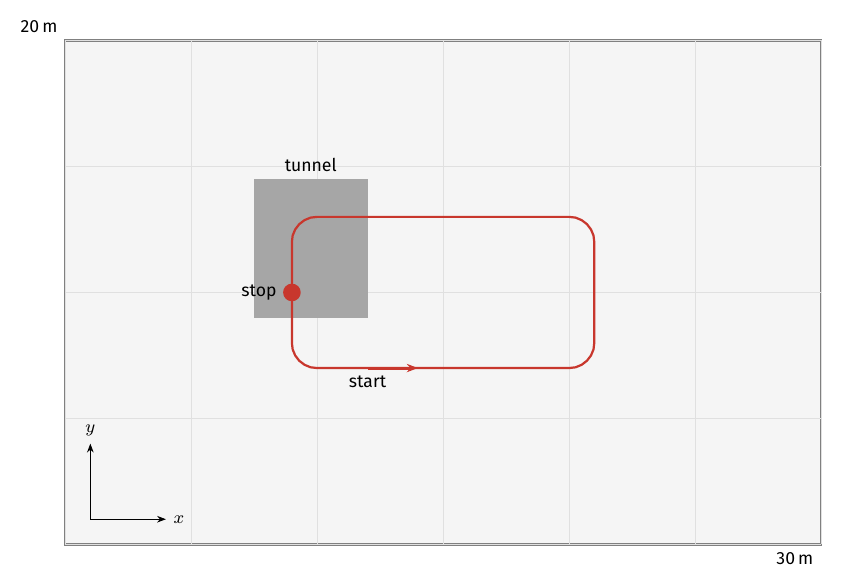
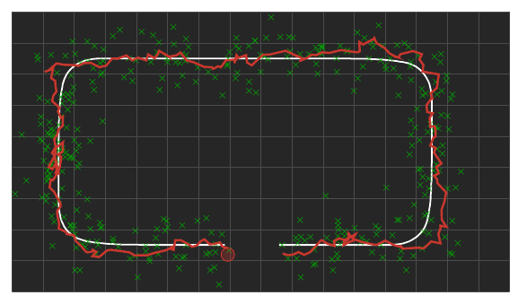
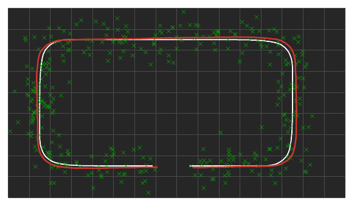
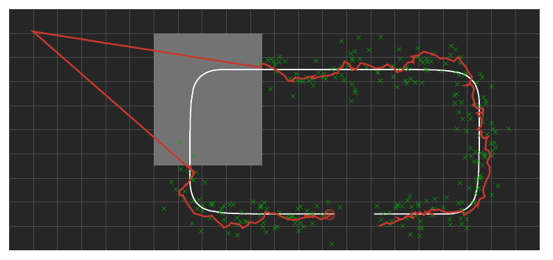
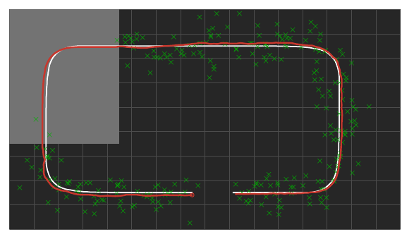
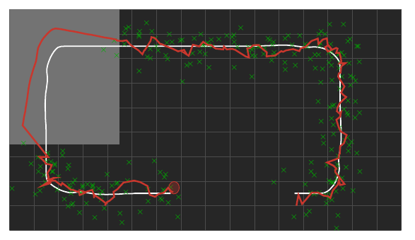
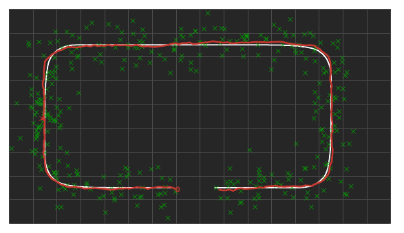
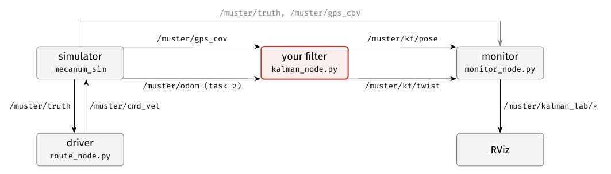

# ohm_kalman_localization

Lab 3 of *Intelligent Robotics* for the simulator [ir-mecanum-lab](https://github.com/christianpfitzner/ir-mecanum-lab):
a robot drives a loop, and a Kalman filter you write finds out where it is, from GPS and odometry.
Handout: [docs/kalman.pdf](docs/kalman.pdf).



## Tasks

| task | what | terminal 1 | terminal 2 |
|---|---|---|---|
| 0 | the sensors: topics, messages, rates, live plots | `ros2 launch ohm_kalman_localization kalman.launch.py` | — |
| 1 | linear Kalman filter with GPS alone (STUDENT 1.1–1.5) | as task 0 | `ros2 run ohm_kalman_localization kalman_node.py --ros-args -p task:=1` |
| 2 | GPS and the velocity of the odometry (2.1), then through the tunnel | as task 0, then with `gps:=tunnel` | `... --ros-args -p task:=2 -p sigma_v:=0.2` |
| 3 | the EKF of `robot_localization`, configured in `config/ekf.yaml` | `... kalman.launch.py gps:=tunnel` | `ros2 launch ohm_kalman_localization ekf.launch.py` |
| 4 (extra) | an EKF of your own, heading in the state (4.1–4.3), reset service (4.4, 4.5) | as task 0 | `... --ros-args -p task:=4 -p sigma_v:=0.2` |

Your code: `student/kalman_filter.py`, `student/models.py`, two blocks of task 4 in `student/kalman_node.py`.
Tests without the simulator: `python3 -m pytest test -q -k task1` (`task2`, `task4`). Hints, one at a time:
`python3 hint.py 1.3`. Plots of the last run: `ros2 run ohm_kalman_localization plot_run.py`.

| task 1, GPS alone | task 2, GPS and odometry |
|---|---|
|  |  |
| **tunnel, GPS alone** | **tunnel, GPS and odometry** |
|  |  |
| **task 3, `robot_localization`** | **task 4, your own EKF** |
|  |  |

White: the true path, green: the GPS fixes, red: the estimate and its 1σ ellipse, as in RViz.

## Nodes and topics



## ROS tools

The ROS 2 documentation at [docs.ros.org](https://docs.ros.org/en/jazzy/) replaces the ROS wiki
(wiki.ros.org, ROS 1).

| tool | used for | documentation |
|---|---|---|
| `colcon build` | building the workspace | [colcon tutorial](https://docs.ros.org/en/jazzy/Tutorials/Beginner-Client-Libraries/Colcon-Tutorial.html) |
| `ros2 launch` | simulator, driver, monitor and RViz in one command | [launch files](https://docs.ros.org/en/jazzy/Tutorials/Intermediate/Launch/Launch-Main.html) |
| `ros2 run` | your filter node | [nodes](https://docs.ros.org/en/jazzy/Tutorials/Beginner-CLI-Tools/Understanding-ROS2-Nodes/Understanding-ROS2-Nodes.html) |
| `ros2 topic list / hz / echo` | task 0: the sensors | [topics](https://docs.ros.org/en/jazzy/Tutorials/Beginner-CLI-Tools/Understanding-ROS2-Topics/Understanding-ROS2-Topics.html) |
| `ros2 interface show` | the fields of `PoseWithCovarianceStamped`, `Odometry`, `Trigger` | [interfaces](https://docs.ros.org/en/jazzy/Concepts/Basic/About-Interfaces.html) |
| RViz | truth, GPS fixes, estimate and its ellipse | [RViz user guide](https://docs.ros.org/en/jazzy/Tutorials/Intermediate/RViz/RViz-User-Guide/RViz-User-Guide.html) |
| `rqt_plot` | live plots of message fields, e.g. the covariance in the tunnel | [rqt](https://docs.ros.org/en/jazzy/Concepts/Intermediate/About-RQt.html), [rqt_plot](https://github.com/ros-visualization/rqt_plot) |
| `ros2 param set` | changing parameters of the running node (task 4) | [parameters](https://docs.ros.org/en/jazzy/Tutorials/Beginner-CLI-Tools/Understanding-ROS2-Parameters/Understanding-ROS2-Parameters.html) |
| `ros2 service call` | `/kalman/reset` (task 4) | [services](https://docs.ros.org/en/jazzy/Tutorials/Beginner-CLI-Tools/Understanding-ROS2-Services/Understanding-ROS2-Services.html), [a service in Python](https://docs.ros.org/en/jazzy/Tutorials/Beginner-Client-Libraries/Writing-A-Simple-Py-Service-And-Client.html) |
| `robot_localization` | the standard EKF of ROS (task 3) | [robot_localization](https://docs.ros.org/en/rolling/p/robot_localization/) |

`rqt_plot`: start it with `ros2 run rqt_plot rqt_plot` and type the fields into the box *Topic*, e.g.
`/muster/kf/pose/pose/covariance[0]`. Fields given on the command line are dropped while ROS 2 still discovers
the topics.

## Install

```bash
sudo apt install ros-$ROS_DISTRO-robot-localization ros-$ROS_DISTRO-rqt-plot
cd ~/ros2_ws/src
git clone git@github.com:christianpfitzner/ir-mecanum-lab.git
git clone git@github.com:christianpfitzner/ohm-kalman-localization.git
cd ~/ros2_ws
colcon build --symlink-install --packages-select mecanum_lab_interfaces mecanum_lab ohm_kalman_localization
source install/setup.bash
```

Launch arguments of `kalman.launch.py`: `gps:=open|tunnel`, `speed:=`, `robot:=`, `rviz:=`, `headless:=`, `seconds:=`.

## Parameters of the node

| parameter | default | |
|---|---|---|
| `task` | 1 | 1 GPS only · 2 GPS and odometry · 4 EKF (task 3 is `ekf.launch.py`) |
| `sigma_a` | 0.3 | m/s², process noise Q; 0 = Q = 0 |
| `sigma_v` | 0.05 | m/s, noise of the odometry velocity (tasks 2, 4) |
| `sigma_w` | 0.05 | rad/s, noise of the odometry turn rate (task 4) |
| `theta0`, `sigma_theta0` | 0, 0.5 | rad, initial heading of the EKF and its σ |
| `sigma_v0`, `rate` | 1.0, 10 | initial σ of the velocity, Hz of the prediction |
